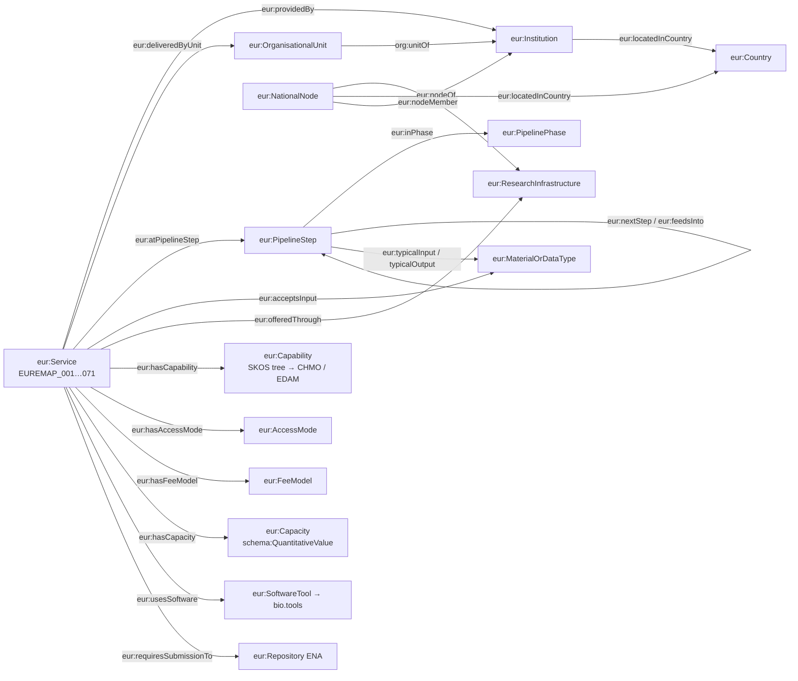

# EUREMAP Ontology and Service Knowledge Graph (v0.2.0)

An RDF/OWL schema plus instance graph for the [EUREMAP Pipeline of Marine Bioprospecting Services Catalogue](https://services.euremap.eu/), with all 71 services, 9 pipeline steps, 11 institutions, 9 countries, 3 research infrastructures and 10 national nodes. It is designed as EUREMAP's semantic control plane: it describes and links services for discovery, routing and governance, and does not hold scientific data.

Website: [https://euremap.github.io/euremap-kg](https://euremap.github.io/euremap-kg)

Source: catalogue listing and the 71 service detail pages (e.g. [EUREMAP_021](https://services.euremap.eu/service/euremap_021/)), retrieved 2026-11-19.

## Package contents

| Path | Content |
|---|---|
| `ontology/euremap-ontology.ttl` | TBox: OWL classes, object/datatype properties, property chain, SKOS concept schemes (308 lines) |
| `data/euremap-catalogue.ttl` | ABox: 71 services, institutions, units, countries, RIs, nodes, steps, capability taxonomy, capacities (2,673 triples) |
| `data/derived-feedsInto.ttl` | Step-to-step routing materialised by query Q07 |
| `data/euremap-services.csv` | Flat table of the 71 services (for spreadsheets / dashboards) |
| `shapes/euremap-shapes.ttl` | SHACL validation shapes (graph currently conforms) |
| `queries/Q01…Q16.rq` | 17 SPARQL queries; `queries/RESULTS.md` holds the actual results |
| `euremap-kg-full.ttl` / `.jsonld` | Ontology + data merged (2,932 triples) |
| `build.py`, `run.py`, `source/` | Reproducible generator, validator/query runner, catalogue snapshot |

## Namespaces

```turtle
@prefix eur: <https://w3id.org/euremap/ontology/> .   # schema terms
@prefix res: <https://w3id.org/euremap/resource/> .   # instances & concepts
```
The `w3id.org/euremap` namespace is provisional until the w3id redirect is registered. Reused vocabularies: DCAT, W3C ORG, SKOS, DCTERMS, PROV-O, Schema.org, FOAF. Alignments: CHMO (analytical chemistry methods), EDAM (bioinformatics), ROR, Wikidata, EU Publications Office country authority, bio.tools. All external identifiers were checked against their source APIs (OLS4, ROR, bio.tools).

## Model



Key design choices:

- **One node per catalogue ID.** Each `EUREMAP_NNN` is one `eur:Service` with exactly one provider and one step (enforced by SHACL).
- **Three phases group the nine steps.** Genomic & biological resources (Genomics, Biomass production), Chemistry (Chemical extraction, Chemical profiling, Chromatography, Structure elucidation, Synthesis), Bioactivity & safety (Bioassays & bioprofiling, Safety & toxicity). A cross-cutting `res:step-fair-data` is included from the [service-pipeline page](https://euremap.eu/service-pipeline/) with no services attached.
- **Routing comes from I/O contracts, not page order.** `eur:nextStep` only records catalogue order. Real routing (`eur:feedsInto`) is derived when one step's typical output is another's typical input. This captures loops such as Chromatography → Bioassays (bioassay-guided fractionation) and Synthesis → Bioassays.
- **Step defaults are kept separate from service statements.** `eur:typicalInput` sits on steps. `eur:acceptsInput` is asserted on a service only where its text says so (e.g. "250 µg of extract per assay").
- **Country nodes come in two forms.** `eur:Country` is the geographic node. `eur:NationalNode` is the research infrastructure × country presence (e.g. EMBRC – Portugal = CCMAR). National nodes are derived from catalogue affiliations, not official membership lists.
- **Capacities are quantitative.** Scales, sample requirements and yields are `schema:QuantitativeValue` with UN/CEFACT unit codes (LTR, GRM, MGM, A56 = MHz), so they can be filtered numerically (Q04).
- **Service–country link via property chain.** `eur:offeredInCountry` is defined as `eur:providedBy ∘ eur:locatedInCountry`. Without a reasoner, use that property path in SPARQL.

## Catalogue field → RDF mapping

| Catalogue field | Predicate | Example object |
|---|---|---|
| Service ID | `dct:identifier` | `"EUREMAP_043"` |
| Title / overview | `dct:title` / `dct:description` | literals @en |
| Pipeline step | `eur:atPipelineStep` | `res:step-chromatography` |
| Institution | `eur:providedBy` | `res:org-uit` (ROR 00wge5k78) |
| Provider unit | `eur:deliveredByUnit` | `res:unit-uit-marbio-…` |
| Country | `eur:providedBy/eur:locatedInCountry` | `res:country-NO` |
| Service type | `eur:hasAccessMode` | `res:access-physical` / `-remote` / `-virtual` |
| Research infrastructure | `eur:offeredThrough` | `res:ri-eu-openscreen` |
| Access & requirements | `eur:accessConditions`, `eur:hasFeeModel`, `eur:requiresPriorContact` | verbatim text, `res:fee-for-service`, `true` |
| Reference URL | `foaf:page` | provider web page |
| Detail page | `dcat:landingPage`, `dct:source` | `https://services.euremap.eu/service/euremap_043/` |
| Techniques in text | `eur:hasCapability` | `res:cap-flash-chromatography` (≡ CHMO:0002582) |
| Scales / amounts | `eur:hasCapacity` | 1–30 mg MGM, purification yield |

## SPARQL examples (see `queries/RESULTS.md` for full output)

| Query | Question answered | Result highlight |
|---|---|---|
| Q01 | Services per step, ordered, with phase | Bioassays 15, Structure elucidation 13, Biomass production 2 |
| Q02 | Country nodes: institutions and services | Norway 18, Portugal 12, Italy 11 |
| Q03 | Antimicrobial assays (all sub-types) via EMBRC | EUREMAP_020, 021, 022, 026 |
| Q04 | Extraction services ≥ 10 L | SINTEF 40 L, MEDINA 20 L |
| Q05 | Pipeline coverage per institution | SINTEF covers all 9 steps; CCMAR and SU 6 each |
| Q06 | Steps available domestically (Portugal) | Gaps: Genomics, Biomass production, Safety & toxicity |
| Q07 / Q07b | CONSTRUCT step routing from I/O contracts | 12 `feedsInto` edges, 15 material hand-offs |
| Q08 | Where can a crude extract go? | 31 services (explicit vs. step default flagged) |
| Q09 | Services using NMR via CHMO:0000591 | 10 services across profiling and structure elucidation |
| Q10 | Usable without travel, per step | Remote/virtual available at every step |
| Q11 | National nodes with members | EU-OPENSCREEN – Norway (SINTEF, UiT) 18 services |
| Q12 | Free services and prerequisites | EUREMAP_001–003: free, ENA submission, MGnify |
| Q13 | Steps not covered by each RI | EMBRC lacks Genomics; EU-OPENSCREEN covers all |
| Q14 | Candidate route Genomics → Structure (NO/FR) | Provider options per step |
| Q15 | Keyword search for a website search box | "kinase", "antifouling" → 028, 019 |
| Q16 | Most common analytical techniques (CHMO) | MS 17, HRMS 15, LC-MS 14, NMR 10 services |

Example (Q03), finding every antimicrobial sub-type through the SKOS hierarchy:

```sparql
SELECT ?id ?title ?provider ?country (GROUP_CONCAT(DISTINCT ?capL; separator="; ") AS ?assays)
WHERE {
  ?cap skos:broader* res:cap-antimicrobial-assay ; skos:prefLabel ?capL .
  ?s eur:hasCapability ?cap ; dct:identifier ?id ; dct:title ?title ;
     eur:offeredThrough res:ri-embrc ; eur:providedBy ?p .
  ?p skos:altLabel ?provider ; eur:locatedInCountry/skos:prefLabel ?country .
}
GROUP BY ?id ?title ?provider ?country
```

## Load and run

```bash
# Fuseki (Docker)
docker run -p 3030:3030 -e ADMIN_PASSWORD=pw stain/jena-fuseki
curl -u admin:pw -X POST "http://localhost:3030/$/datasets" -d "dbName=euremap&dbType=tdb2"
curl -u admin:pw -X POST "http://localhost:3030/euremap/data?default" \
     -H "Content-Type: text/turtle" --data-binary @euremap-kg-full.ttl

# or locally with Python
pip install rdflib pyshacl && python3 run.py   # validates SHACL and runs every query
```

To refresh from the live catalogue, replace `source/catalogue-snapshot-*.json` and rerun `build.py`.

## Data-quality notes

- **Facet counts differ from records.** The catalogue's filter counts (e.g. Norway 20, EU-OPENSCREEN 42, EMBRC 36) are higher than what the 71 individual records give (Norway 18, EU-OPENSCREEN 37, EMBRC 31). The graph uses the per-record values.
- **One overview mismatch.** EUREMAP_061's title is "1D/2D NMR interpretation", but its overview describes stereochemistry (Mosher/Marfey), so it carries both sets of tags. This is worth checking with MEDINA.
- **Spelling fixes keep the original.** Corrected labels are stored as `skos:prefLabel`, and the catalogue spelling is kept as `eur:catalogueLabel` ("Artic" → "Arctic", "Ecostustainable" → "Ecosustainable").
- **Capability tags are automatic.** They come from controlled keyword rules over each service's title and overview, limited to the relevant steps. They are a curation starting point, not provider-confirmed statements.
- **No personal contact data.** Personal contact e-mails from the detail pages are left out on purpose. Add them as `dcat:contactPoint` (vCard) if partners agree.
- **No service-level genomics → wet-lab hand-off.** Genomics outputs (BGC predictions) inform strain selection rather than physically feeding Biomass production. A future `eur:informs` relation would model this decision link.
